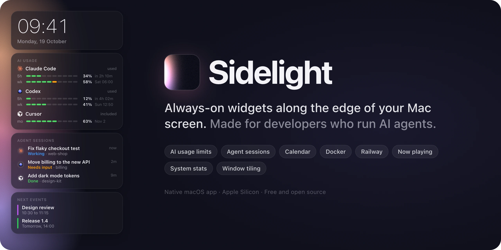

<p align="center">
  
</p>

<p align="center">
  <a href="https://github.com/50BytesOfJohn/sidelight/releases/latest"></a>
  <a href="https://github.com/50BytesOfJohn/sidelight/actions/workflows/ci.yml"></a>
  
  <a href="LICENSE"></a>
</p>

Sidelight puts a strip of widgets along one edge of your Mac screen and keeps it there. You can see how much
of your Claude Code, Codex and Cursor limits you have left, which agent sessions need you, what's next on your
calendar and what's playing, all without switching windows.

Other windows move or shrink so they never sit under the panel. It's a native macOS app that uses almost no
CPU while idle, so it can stay open all day.

## Install

```sh
brew install --cask 50bytesofjohn/tap/sidelight
```

Or download the DMG from the [latest release](https://github.com/50BytesOfJohn/sidelight/releases/latest),
open it and drag Sidelight to Applications.

Sidelight needs an Apple Silicon Mac with macOS 26 or later. On first launch macOS asks for Accessibility
access, which Sidelight uses to move other apps' windows out of the panel's way. Sidelight updates itself, and
you can change how in Settings › General › Updates.

## Widgets

Add, remove and reorder widgets in the Widgets window. Many come in several styles and sizes, and you can add
the same widget more than once with different settings.

### AI agents

| Widget               | Shows                                                         | Needs                                                      |
| -------------------- | ------------------------------------------------------------- | ---------------------------------------------------------- |
| AI Usage             | Codex, Claude Code and Cursor limits side by side in one card | Whatever each agent it shows needs (below)                 |
| Claude Code          | Your plan's 5-hour and weekly limits, for one or more accounts | A Pro or Max plan, connected through Claude Code's status line |
| Codex                | Plan limits and token use                                     | The `codex` CLI (`brew install codex`), signed in          |
| Cursor               | Included usage this billing cycle                             | The Cursor app or `cursor-agent`, signed in                |
| Claude Code sessions | Running sessions and whether they're working, need input or are done | A recent Claude Code                                |
| Codex sessions       | Sessions and their plans                                      | A recent Codex (CLI, desktop app or IDE extension)         |
| Agent sessions       | Claude Code, Codex, Cursor and OpenCode sessions in one list  | The agents you choose to list                              |

### Cloud

| Widget                 | Shows                                          | Needs                                              |
| ---------------------- | ---------------------------------------------- | -------------------------------------------------- |
| Docker (beta)          | Running containers by Compose project, and their health | Docker Desktop, OrbStack or Colima         |
| Railway (beta)         | Your services and deploys, the bill so far, and incidents | The `railway` CLI, signed in           |
| OpenRouter (beta)      | New models, balances and spending              | An API key, for balances only                      |
| Noodle Computer (beta) | Which of your Noodle computers are running     | The Noodle Computer app                            |

### Essentials

| Widget       | Shows                                                        | Needs                                                   |
| ------------ | ------------------------------------------------------------ | ------------------------------------------------------- |
| Clock        | Time and date, in many styles                                |                                                         |
| Next events  | Today's and tomorrow's events                                | Calendar access, which the widget asks for              |
| Now playing  | The track that's playing, from any app                       | `brew install ungive/media-control/media-control`       |
| System       | CPU and memory use                                           |                                                         |
| App Launcher | Your apps, one click away, with a dot on the running ones    |                                                         |
| Stash        | Prompts and snippets saved with a shortcut, ready to paste into an agent | Accessibility access, to stash selected text |
| Awake        | A switch that keeps your Mac from sleeping                   |                                                         |
| Battery      | Charge, whether it's charging, and time left                 | A Mac with a battery                                    |

Some widgets open a full-height details panel in place of the side panel when you click them, for example to
browse every OpenRouter model or see a container's CPU and memory.

## Make it yours

- Put the panel on the left or right edge, or turn it into a bar along the top or bottom.
- Show it on the main display only or on every display. Each display can have its own settings.
- Choose what's behind the widgets: Liquid Glass, blur, a solid color or gradient, a picture (your desktop
  picture by default), or nothing at all. Add film grain if you like.
- Give pictures an effect: dither, halftone, pixelate, posterize, duotone or ASCII.
- Show or hide the panel with a global shortcut.

## Work around it

Sidelight keeps other windows out from under the panel. When a window would overlap it, Sidelight moves or
shrinks the window. It also works with [Rectangle](https://rectangleapp.com).

If you don't use a window manager, turn on the built-in one in Settings. Its shortcuts tile the frontmost
window into halves, thirds, two-thirds and corners, maximize or center it, or send it to another display.
Pressing a half again cycles it through ½, ⅓ and ⅔. It comes with Sidelight, Rectangle and Spectacle shortcut
presets.

## Light on your Mac

Sidelight runs all day, so it does as little as it can while you aren't looking at it. Each data source runs
only while a widget that uses it is on screen. Widgets get told when something changes (an app opens, a Docker
container stops) instead of asking on a timer wherever the source allows it. The one animated background, a
slowly drifting gradient, is off until you turn it on.

## Your data

Sidelight reads usage and sessions from the tools already on your Mac: their CLIs, local files and sign-ins. It
has no account of its own and no analytics. Fetching Cursor's usage from its dashboard and refreshing Claude
limits from Anthropic are both off until you turn them on.

Your settings live in `~/Library/Application Support/Sidelight/config.json`. Edits to the file apply
immediately, and updates keep it working.

## Where it's going

Sidelight is young and changes quickly. Next up are ways for agents to push updates to the panel ("finished",
"needs your input") and to build widgets for their users. [docs/VISION.md](docs/VISION.md) has the reasons
behind the app and the plans for it.

## Contributing

Bug reports, widget ideas, fixes and new widgets are welcome. [CONTRIBUTING.md](CONTRIBUTING.md) covers building
from source and the pull request workflow, and [docs/ARCHITECTURE.md](docs/ARCHITECTURE.md) maps out the code.
Please follow the [Code of Conduct](CODE_OF_CONDUCT.md), and report security issues privately as described in
[SECURITY.md](SECURITY.md).

## License

[MIT](LICENSE). Provider logos belong to their owners; see [docs/BRAND_ASSETS.md](docs/BRAND_ASSETS.md).
